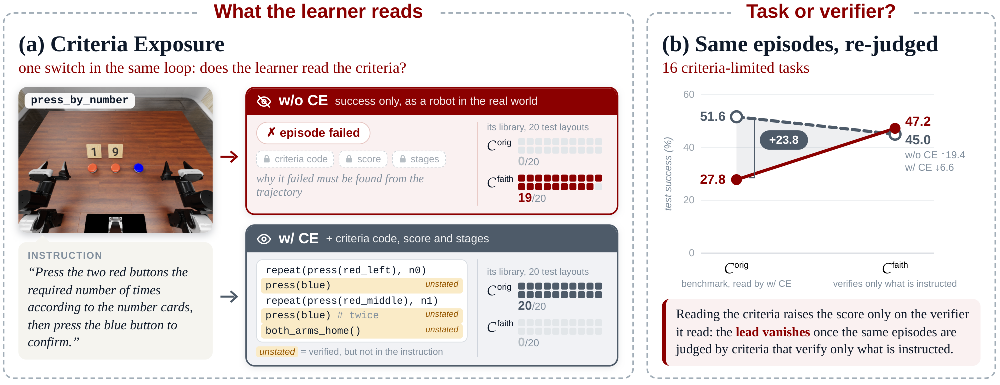
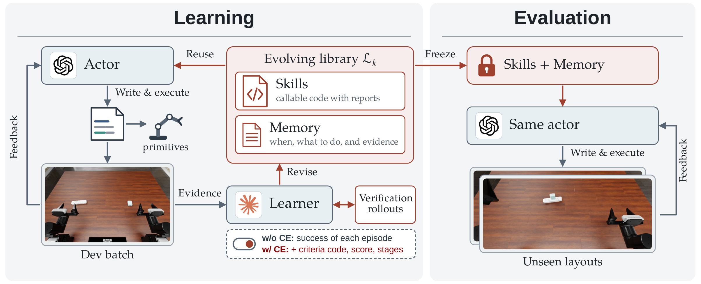
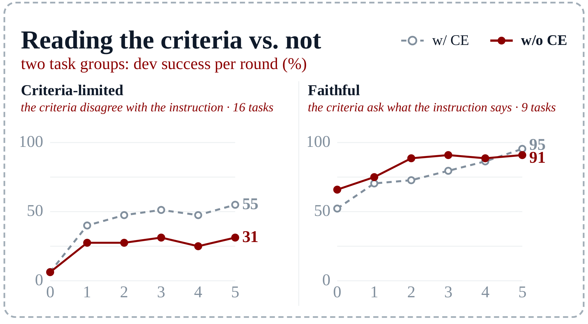
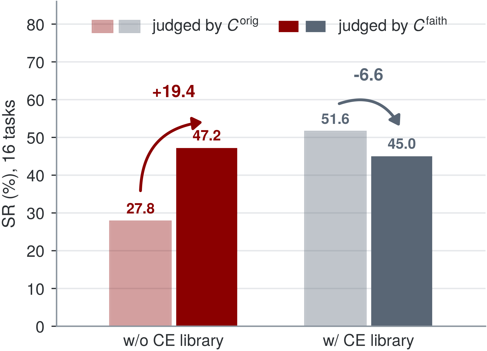
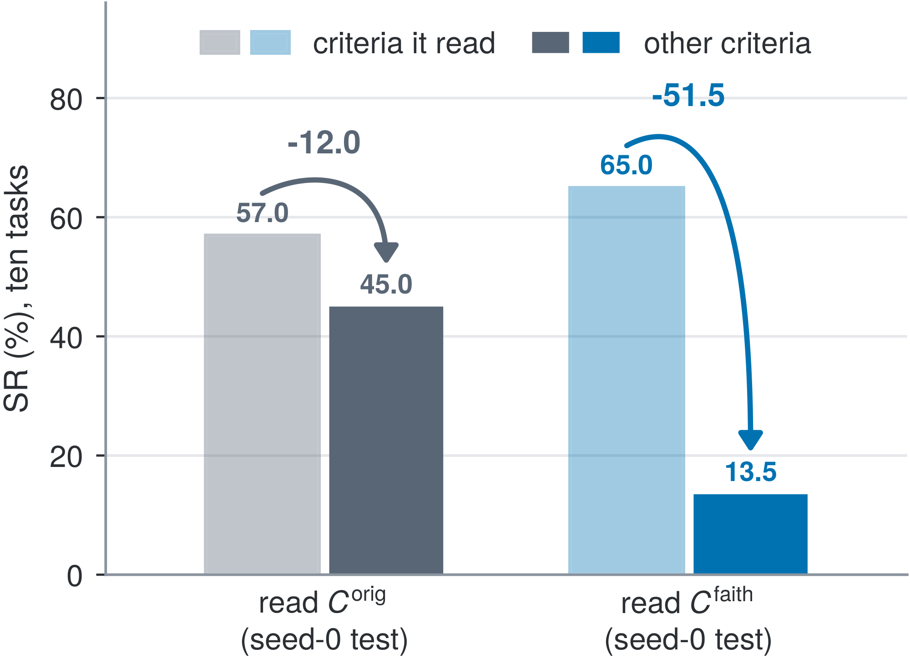
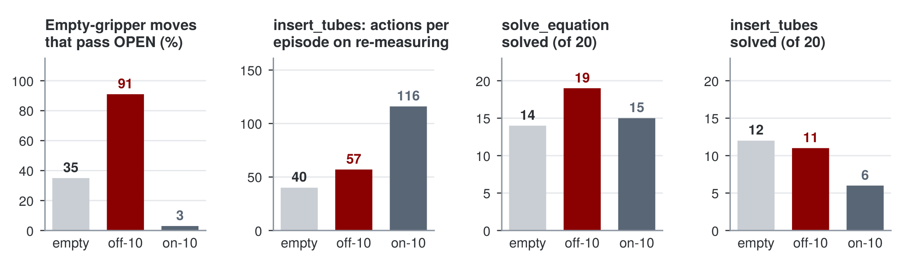

<div align="center">

# Learning the Task or Learning the Verifier? Rethinking Criteria Exposure in Embodied Self-Improvement

Wenbo Huang<sup>1</sup>, Jianxin Bi<sup>1,2</sup>, Shunyu Yang<sup>1</sup>, Ruiyang Si<sup>1</sup>, Rui Ni<sup>1</sup>, Qiang Wang<sup>1</sup>, Shulong Jiang<sup>1</sup>, Yintianrun Zhang<sup>1</sup>, Feixiang Ruan<sup>1</sup>, Kewei Zhang<sup>1</sup>, Ye Huang<sup>1</sup>, Shukai Gong<sup>1</sup>, Daquan Zhou<sup>1,†</sup>

<sup>1</sup>Peking University &nbsp; <sup>2</sup>National University of Singapore

<sup>†</sup>Corresponding author

[](https://dagroup-pku.github.io/PyRUA-Lean/RSIJudge/)
[](https://arxiv.org/abs/2611.08318)
[](LICENSE)

</div>

<p align="center">
  
</p>

Self-improving embodied agents are developed and compared on robot simulation benchmarks, and
several of them let the learner read the benchmark's success criteria, a practice we call
**Criteria Exposure (CE)**. But those criteria were written to judge policies trained on
demonstrations, and they often verify more than the instruction says: in RoboDojo's
`press_by_number`, the blue button must be pressed exactly twice, between the two red groups,
which the instruction never states (above, a).

**When a self-improving agent reads the criteria, does the code it learns perform the instructed
task better, or does it overfit to the verifier?** We run one self-improvement loop in two
settings that differ in a single switch, and judge every test episode twice: by the benchmark's
original criteria $C^{orig}$ and by instruction-faithful criteria $C^{faith}$ that verify only what
the instruction asks. Exposure's lead under $C^{orig}$, 51.6% against 27.8%, is gone under
$C^{faith}$: 45.0% against 47.2% on the same episodes (above, b).

This repository holds everything needed to rerun the study: the loop, the instruction-faithful
criteria with dual judging, the evaluations, the library transfer to new tasks, LIBERO-PRO and
RoboCasa365, and the configurations of every experiment.

## How the study works

<p align="center">
  
</p>

- **Actor** (frozen): GPT-6 Astra, reasoning effort high, writes and runs Python cells against the
  robot API `robo` of [PyRUA-Lean](https://github.com/DAGroup-PKU/PyRUA-Lean): RGB perception
  (SAM 3 and multi-view measurement) and motion primitives, with no VLA, depth or simulator state.
- **Learner**: Claude Code with Claude Opus 5.5 (effort high). Between batches it turns the last
  batch's evidence into one revision of a per-task **library**: *skills* (callable code that
  reports what it did) and *memory* entries (when to apply what, with the evidence), checking
  changes with verification rollouts.
- **Loop**: five rounds on five development layouts per task; a batch that falls clearly below the
  best one rolls the library back. Everything but the library is frozen.
- **The one switch**: what the learner reads.

| Setting | The learner reads | Switch |
|---|---|---|
| **w/o CE** | trajectories and whether each episode succeeded, as a robot in the real world would | `--worker-scoring off` |
| **w/ CE** | also the task's criteria code, and each episode's score and stages | `--worker-scoring on` |

Of the 25 RoboDojo tasks we learn, 16 are **criteria-limited** (their criteria disagree with the
instruction on some trajectories) and 9 are **faithful**; the groups were fixed before any result
was seen. For the criteria-limited tasks we rewrote only the judging code into $C^{faith}$
([`faithful_criteria/`](faithful_criteria/README.md)): hidden rules removed, defects fixed, hard thresholds
relaxed to what still clearly satisfies the instruction, the return of both arms kept.

## Findings

### 1. Exposure pays off only where the criteria ask for more than the instruction

<p align="center">
  
</p>

Test success under the original criteria (SR, %, layouts 0–19 of seed 0; change against the empty
library in parentheses):

| Tasks | Empty library | w/o CE | w/ CE |
|---|:---:|:---:|:---:|
| All (25) | 24.6 | 47.8 (+23.2) | 62.0 (+37.4) |
| Criteria-limited (16) | 8.4 | 27.8 (+19.4) | **51.6 (+43.2)** |
| Faithful (9) | 53.3 | **83.3 (+30.0)** | 80.6 (+27.3) |

Learning from success alone doubles success; reading the criteria adds 14.2 points more, all of it
on criteria-limited tasks. Where the criteria verify what the instruction says, the two settings
are level.

### 2. The lead follows the criteria it read

<table>
  <tr>
    <td width="50%" align="center"></td>
    <td width="50%" align="center"></td>
  </tr>
  <tr>
    <td><b>Re-judging the same episodes.</b> Under C<sup>orig</sup> the exposed library alone succeeds on 93 layouts, the success-only one alone on 17. Under C<sup>faith</sup> it is 47 against 54 (p = 0.55): the gap shrinks by 25.9 points (95% interval over tasks 4.7–54.4).</td>
    <td><b>Swapping the criteria that are read.</b> A learner that reads C<sup>faith</sup> reaches 65.0% under C<sup>faith</sup> and only 13.5% under C<sup>orig</sup>; the one that read C<sup>orig</sup> falls from 57.0% to 45.0%. Each exposed library scores best under the criteria it read.</td>
  </tr>
</table>

### 3. What exposure adds does not carry over

The libraries of ten source tasks are distilled into one shared library per setting and applied to
tasks no source covers, and, translated to each target's primitives, to LIBERO-PRO and
RoboCasa365 (successes; change against the empty library):

| Target | Library source | Empty | w/o CE | w/ CE |
|---|---|:---:|:---:|:---:|
| RoboDojo, 10 new tasks × 20 layouts | RoboDojo | 65/200 | **80/200** (+15) | 71/200 (+6) |
| LIBERO-PRO, 6 tasks × 10 seeds | RoboDojo | 45/60 | 48/60 (+3) | 46/60 (+1) |
| RoboCasa365, 10 tasks × 10 seeds | RoboDojo | 22/100 | 24/100 (+2) | 24/100 (+2) |
| RoboCasa365, 10 tasks × 10 seeds | RoboCasa365 | 22/100 | **33/100** (+11) | 29/100 (+7) |

The 14-point lead of exposure on its own tasks does not reappear on new ones, and across
benchmarks only experience gathered within the target benchmark helps.

<details>
<summary>What carries over within RoboDojo (case study)</summary>

<p align="center">
  
</p>

General rules carry over, single-task precision does not. From the same source failures, the
success-only learner traced the cause and its distilled library (off-10) holds a general rule:
pass `OPEN` on every move of an empty gripper. The actor follows it on the new tasks (91% of such
moves, against 35% with the empty library), and `solve_equation`, which needs a thin disc picked
up, rises to 19/20. The exposed library (on-10) kept a single-task formula and asks to re-measure
to 1 mm before most actions: on `insert_tubes` it spends 116 of 500 actions per episode
re-measuring and solves 6/20, against 12 with the empty library.
</details>

**Takeaway.** Give the learner only the feedback a robot would get in the real world, and let the
benchmark's criteria verify what the instruction says. A gain that holds when the criteria change
reflects what the agent learned about the task.

## Repository layout

| Path | What |
|---|---|
| [`src/pyrualean/`](src/pyrualean) | the PyRUA-Lean package: the robots (`robodojo_xpl_rgb`, `libero_rgb`, `robocasa_rgb`), prompts, agent runtimes (OpenAI-compatible, Codex CLI, replay) and the self-improvement loop [`pyrualean.learn`](src/pyrualean/learn) |
| [`src/xpolicylab_adapter/`](src/xpolicylab_adapter) | the XPolicyLab adapter RoboDojo's evaluation client talks to |
| [`faithful_criteria/`](faithful_criteria/README.md) | $C^{faith}$ for RoboDojo: an overlay of the judging code, built into a source root that judges every episode by both criteria |
| [`eval/robodojo/`](eval/robodojo/README.md) | RoboDojo: evaluate the final libraries of learn campaigns on held-out layouts; [`eval/robodojo/compare.py`](eval/robodojo/compare.py) pairs two settings layout by layout |
| [`eval/libero/`](eval/libero/README.md), [`eval/robocasa/`](eval/robocasa/README.md) | the same for LIBERO-PRO and RoboCasa365, several libraries side by side |
| [`transfer/`](transfer/README.md) | distill the libraries of ten source tasks into one; translate RoboDojo libraries to LIBERO-PRO and RoboCasa365 |
| [`configs/`](configs) | the paper's learn campaigns and evaluation plans, as templates |
| [`tools/`](tools) | environment, config rendering, launchers, clean CLI wrappers, offline tests, release check |
| [`docs/`](docs) | [setup](docs/SETUP.md) · [models and credentials](docs/MODELS.md) · [reproducing the paper](docs/REPRODUCE.md) |

## Quick start

```bash
# 1. environments, benchmark and checkpoints: docs/SETUP.md
cp paths.env.example paths.env && $EDITOR paths.env
source tools/env.sh

# 2. offline tests (no simulator, GPU or model)
bash tools/test_offline.sh "$CE_PYTHON"

# 3. a smoke campaign: one task, one dev layout, two rounds (about two episodes and one learner session)
export ACTOR_API_KEY=...                       # the actor's OpenAI-compatible endpoint (docs/MODELS.md)
python tools/render_config.py configs/learn/robodojo/smoke.json runs/smoke.json
python -m pyrualean.learn.campaign runs/learn/smoke init --config runs/smoke.json
python -m pyrualean.learn.campaign runs/learn/smoke check-services
bash tools/run_learn.sh runs/learn/smoke --worker-scoring off
tail -f runs/learn/smoke/run.log

# 4. once it is done: export its library and test it on one seed-0 layout
python tools/render_config.py configs/eval/robodojo/smoke.json runs/eval-smoke.json
python eval/robodojo/export.py runs/eval/smoke --config runs/eval-smoke.json
bash eval/robodojo/run_eval_env.sh runs/eval/smoke
python eval/robodojo/run.py runs/eval/smoke report
```

The learner uses the `claude` CLI's own login (`tools/claude-clean auth login`) or
`ANTHROPIC_API_KEY`; [docs/MODELS.md](docs/MODELS.md) covers gateways and the Codex runtime.
Every experiment of the paper, section by section, is in [docs/REPRODUCE.md](docs/REPRODUCE.md):

| Paper | Experiment | Configs |
|---|---|---|
| §4.1, Table 1, Fig. 3 | 25 tasks, w/o CE and w/ CE, against the empty library | `configs/learn/robodojo/group{1..5}.json`, `configs/eval/robodojo/test-{orig,empty}.json` |
| §4.2.1, Fig. 1b, 4 | re-judging the 16 criteria-limited tasks | `configs/eval/robodojo/test-dual16.json` |
| §4.2.2, Fig. 5 | the learner reads $C^{faith}$ | `configs/learn/robodojo/faithful10.json`, `configs/eval/robodojo/test-faithful10.json` |
| §4.3, Table 2 | transfer to new tasks, LIBERO-PRO and RoboCasa365 | `transfer/`, `configs/eval/robodojo/transfer-rest10*.json`, `configs/eval/libero/`, `configs/eval/robocasa/`, `configs/learn/robocasa/` |

## Requirements

- RoboDojo at commit `cb2a37d58dbb` with the submodules it records (XPolicyLab `53c5da5a01bc`,
  cuRobo `d17b54ce32cb`), its assets (HF dataset `RoboDojo-Benchmark/RoboDojo`, revision
  `35efbc7dedfdbeeb6e95fb749bd885d73d483e41`), Isaac Sim 5.1.0 and Isaac Lab 0.54.3;
  one GPU with about 45 GB free per RoboDojo episode.
- SAM 3 (`facebook/sam3`, `sam3.pt`).
- Optional: RPent's LIBERO-PRO environment; a RoboCasa365 kitchen environment (robocasa 1.0.1
  with the patch in `eval/robocasa/patches/`, robosuite 1.5.2, MuJoCo 3.3.1 exactly).
- An actor model behind an OpenAI-compatible endpoint (or the Codex CLI), and Claude Code for the
  learner (Node.js 22 or later).

## Notes on reproduction

- Model calls cost money: a learn round is five actor episodes and one learner session; a test
  is 20 episodes per task and library. Start with the smoke configs.
- Development uses layouts 0–4 of evaluation seed 1, testing layouts 0–19 of seed 0; layouts the
  benchmark marks unstable are replaced by the next one in the official order.
- Development batches are noisy (rerunning one library on one layout changes the verdict often):
  draw conclusions from the test layouts, paired layout by layout.
- The evaluations refuse to run when the policy code, the benchmark or the execution settings
  differ from those the libraries were learned with (an execution identity is recorded and
  checked), and `tests/test_paper_prompts.py` fails if the actor's prompt changes.
- `faithful_criteria/` changes only the judging code. In the w/o CE setting, nothing should read or tune
  against the criteria: that is the point of the comparison.

## Citation

```bibtex
@article{huang2026criteria,
  title   = {Learning the Task or Learning the Verifier? Rethinking Criteria Exposure in Embodied Self-Improvement},
  author  = {Huang, Wenbo and Bi, Jianxin and Yang, Shunyu and Si, Ruiyang and Ni, Rui and Wang, Qiang and
             Jiang, Shulong and Zhang, Yintianrun and Ruan, Feixiang and Zhang, Kewei and Huang, Ye and
             Gong, Shukai and Zhou, Daquan},
  journal = {arXiv preprint arXiv:2611.08318},
  year    = {2026}
}
```

## License

Apache License 2.0 (see [LICENSE](LICENSE) and [NOTICE](NOTICE)). `faithful_criteria/reward_manager/` and `faithful_criteria/tasks/` hold
modified files of RoboDojo (MIT License, Copyright (c) 2026 RoboDojo Contributors). The figures
in `docs/assets/` are from the paper.
