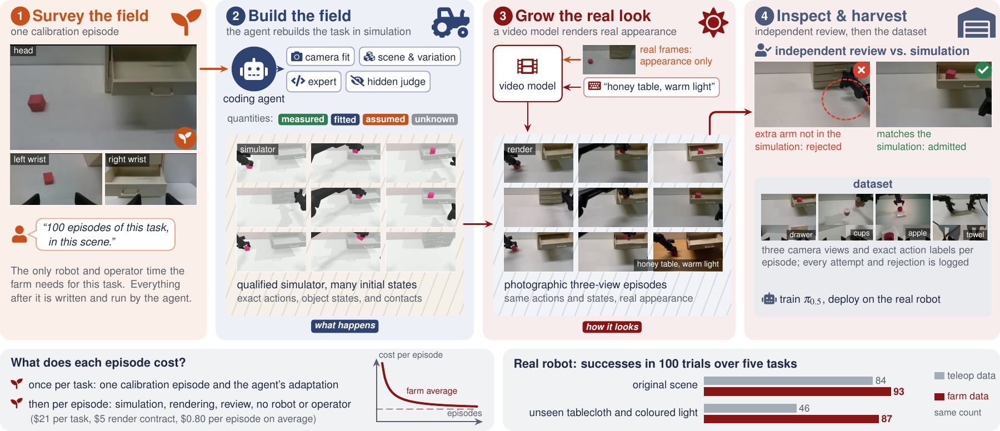
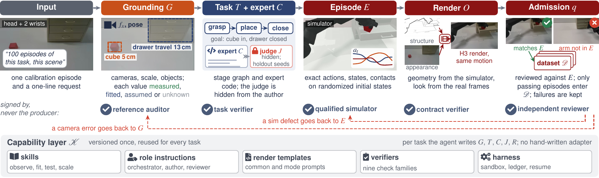
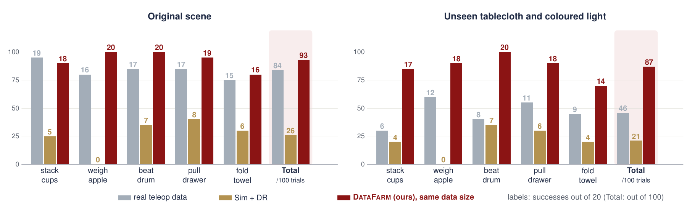
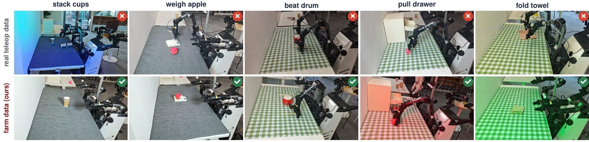
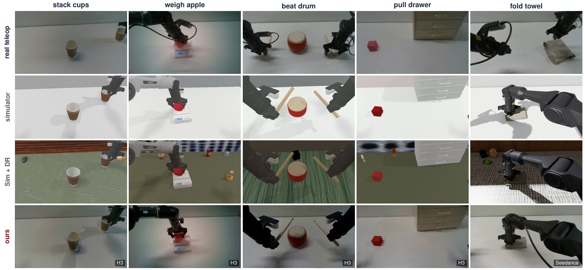
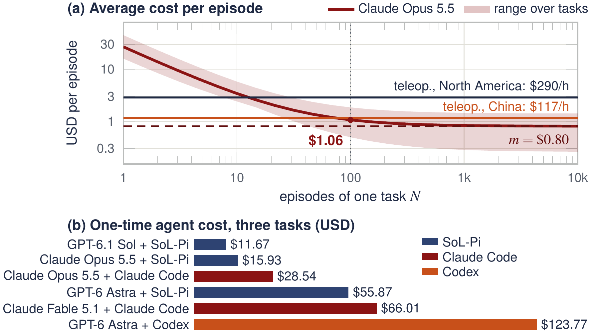

<div align="center">

# PyRUA-DataFarm: LLM Agent as a Cost-Efficient Teleoperator for Real-Ready Robot Data

Kewei Zhang<sup>1,*</sup>, Juncheng Ma<sup>1,*</sup>, Guodong Lv<sup>1</sup>, Duomin Wang<sup>2,†</sup>, Feixiang Ruan<sup>1</sup>, Ruiyang Si<sup>1</sup>, Chuanrui Zhang<sup>2</sup>,
Yuxuan Chen<sup>1</sup>, Hao Chen<sup>1</sup>, Yichen Liu<sup>1</sup>, Yintianrun Zhang<sup>1</sup>, Yufan Deng<sup>1</sup>, Enze Xie<sup>2,†</sup>, Daquan Zhou<sup>1,†</sup>

<sup>1</sup>Peking University &nbsp; <sup>2</sup>NVIDIA &nbsp; <sup>*</sup>Equal contribution &nbsp; <sup>†</sup>Project lead

[](https://arxiv.org/abs/2611.05320)
[](https://xiwen1.github.io/PyRUA-DataFarm/)
[](LICENSE)
[](pyproject.toml)

</div>

<p align="center"></p>

**DataFarm** lets a coding agent do the teleoperator's job. From a data request and **one
calibration episode** of the robot in its scene, the agent rebuilds the task in simulation, and a
video model conditioned on real images renders each rollout as photographic video. The result is
*real-ready data*: synchronized camera views labelled with exact actions, which a policy can train
on directly.


https://github.com/user-attachments/assets/e8ea2b91-7e17-48fe-b9a8-e1ebeccad789


## Contents

- [How it works](#how-it-works)
- [Results](#results)
- [Design principles](#design-principles)
- [Installation](#installation)
- [Quickstart](#quickstart)
- [Reproducing the paper](#reproducing-the-paper)
- [Repository layout](#repository-layout)
- [Documentation](#documentation)
- [Limitations](#limitations)
- [Citation](#citation)
- [License and acknowledgements](#license-and-acknowledgements)

## How it works

<p align="center"></p>

The agent builds five intermediate representations: the grounding *G*, whose quantities are each
labelled by how they are known; the task contract *T* and the expert *C*, written against a hidden
judge *J*; the simulated episodes *E*; the rendered observations *O*; and the admission record *q*.
Code enforces the frozen judge, the checks on every provider request, content-bound review records at
delivery and the certificate before training. Role separation in authoring, and returning a rejection to
the stage that caused it, are required by instruction. The capability layer *K* is shared by all tasks; everything above it is
written for the task at hand.

| Stage | What it produces | Notes |
|---|---|---|
| Capability layer | Role instructions, skills and rules shared by all tasks, compiled into explicit, hash-pinned agent context | [capability-layer](docs/reference/capability-layer.md) |
| Agent runtime | Persistent orchestration, independent review sessions, crash recovery | [agent-runtime](docs/reference/agent-runtime.md) |
| Grounding | Scene, cameras, real references, and a ledger that labels every physical quantity as measured, fitted, assumed or unknown; missing object assets can be generated with USDCraft | [grounding](docs/reference/grounding.md), [usdcraft](docs/reference/usdcraft.md) |
| Simulator qualification | A simulator variant certified for the task's skills | [simulator-qualification](docs/reference/simulator-qualification.md) |
| Task contract and expert | Contract, a judge frozen before the expert exists, and an expert developed in a sandbox and scored on held-out initial states | [expert-harness](docs/reference/expert-harness.md) |
| Render contract | Sim-to-real or out-of-distribution intent, real references, and checks on every request sent to a video model | [render-contract](docs/reference/render-contract.md) |
| Rendering | Photographic video from the MiniMax-H3 control hybrid (default) or Seedance. | [rendering](docs/reference/rendering.md) |
| Verification and admission | Render verifier, mutation calibration, independent review, delivery check, admission certificate | [render-verifier](docs/reference/render-verifier.md), [delivery and admission](docs/reference/delivery-and-admission.md) |
| Policy training | pi0.5 training from admitted data with EEF or delta-EEF actions; absolute-joint mode exists in the launcher but needs a dataset with a joint contract and receipts that no shipped tool builds | [policy-training](docs/reference/policy-training.md) |
| Cost control | A whole-task budget ledger that keeps unknown costs unknown | [cost-control](docs/reference/cost-control.md) |
| Capability evolution | Feedback-driven improvement of the capability layer, judged by a frozen evaluator | [capability-evolution](docs/reference/capability-evolution.md) |
| Run ledger and batch supervisor | Durable records of every requested run, and bounded per-item attempts | [run-ledger](docs/reference/run-ledger.md), [batch-supervisor](docs/reference/batch-supervisor.md) |

## Results

Policies are trained with π<sub>0.5</sub> on 100 episodes from each source and tested in 20 trials per task
and condition. Policies trained only on farm data match teleoperated data in the original scene
and hold up under appearance they have not seen.

| On five real-robot tasks | Teleoperated data | DataFarm data |
|---|---:|---:|
| Successes in the original scene (of 100 trials) | 84 | **93** |
| Successes under an unseen tablecloth and coloured light (of 100 trials) | 46 | **87** |
| Cost per further episode | robot and operator time | **$0.80** of simulation, rendering and review |

<p align="center"></p>
<p align="center"></p>
<p align="center"><em>Unseen-scene trials in which the policy trained on teleoperated data fails (top) and the policy trained only on farm data succeeds (bottom).</em></p>

<p align="center"></p>
<p align="center"><em>Real, simulated and farm episodes at the same task phase (head view). Sim + DR adds domain-randomized textures and lighting to the simulator frame; ours renders the simulator frame. Real and simulated frames come from different episodes, so object placements differ.</em></p>

Adapting a task is fully automatic and costs $21 of API usage on average, paid once per task, plus $5
for a render contract. One hour of synchronized three-view data for a task costs $107 on average,
these costs included, slightly below a quote of $117 for teleoperation in China and below $290 in
labour alone in North America.

<p align="center"></p>
<p align="center"><em>The farm pays once per task, then only for rendering and review: the average cost per episode falls towards the marginal cost as the dataset grows. Flat lines: teleoperation at the farm's mean episode length.</em></p>

## Design principles

- **Task code is an output, not an input.** The adapter, task brief, judge, scene, camera fit
  and video prompts of a new task are generated by the agent. A new task needs no prior
  registration, and this repository ships no per-task artifacts: only the method, the shared
  capability layer and templates.
- **No self-certification.** Enforced by code: the judge is frozen by hash before the expert is
  written and scores it on hidden held-out seeds, and the delivery check accepts only content-bound
  records of a separate review execution. Required by instruction: a separate role writes the judge.
- **Every attempt is kept.** Failures, seeds, provider job IDs, budgets and input hashes are
  recorded. Paid jobs are resumed by their recorded IDs instead of being resubmitted.
- **Fail closed.** Simulators, models, data and credentials are runtime bindings. A missing
  binding stops the tool with a message naming it; nothing falls back to a guess.

## Installation

DataFarm needs Linux and Python 3.11 or newer. Media checks use `ffmpeg`, and the sandbox that
isolates the expert author uses `bubblewrap`.

```bash
git clone https://github.com/DAGroup-PKU/PyRUA-DataFarm.git && cd PyRUA-DataFarm
pip install -e '.[dev,workflow]'
```

The core runtime needs only the standard library and Pillow. The `workflow` extra adds the
imaging and scientific packages used by the verifiers and dataset tools.

The default H3 renderer needs one GPU with at least 172 GB free per worker.

The repository does **not** contain simulators, video models, robot assets, data or
credentials. Install the components you need (see [NOTICE.md](NOTICE.md)) and point DataFarm
at them with runtime bindings:

```bash
$EDITOR bindings.json                           # or point DATAFARM_BINDINGS at the file, or set DATAFARM_<KEY>
datafarm doctor --profile core                  # check prerequisites, no API or GPU calls
```

`bindings.json` maps binding names to paths; [docs/deployment.md](docs/deployment.md) lists them all:

```json
{
  "TRAINING_PYTHON": "/opt/envs/training/bin/python",
  "OPENPI_CACHE": "/data/openpi-cache",
  "DATASETS": "/data/lerobot",
  "GPU_SCHEDULER": "/opt/bin/gpu-scheduler",
  "H3_MODELS": "/data/h3-models"
}
```

## Quickstart

**1. Check the installation.** Run the CPU test suite, the standing-rules lint and the
instruction-layer audit:

```bash
make test lint audit
```

**2. Connect a coding agent.** DataFarm does not include a model or an agent. `supervise` runs the
agent you choose through a runtime config:

| Harness | Runtime config | Before the first run |
|---|---|---|
| SoL-Pi | [`pi-solpi.json`](examples/runtime/pi-solpi.json) | Install Pi and SoL-Pi and configure a model, as below |
| Claude Code | [`claude-code.json`](examples/runtime/claude-code.json) | Install Claude Code and log in |
| Codex | [`native-codex.json`](examples/runtime/native-codex.json) | Install Codex and run `codex login` |

These are the supported harnesses. To connect another CLI, add a profile to
[`agent_cli_driver.py`](examples/runtime/agent_cli_driver.py).

For SoL-Pi and Claude Code, replace `/path/to/PyRUA-DataFarm` in the config with the absolute path of
this checkout. To choose a model, add `"--model", "<model>"` to the end of the driver's `argv`.
[`claude-code.json`](examples/runtime/claude-code.json) runs Claude Code with `bypassPermissions`, so
use a dedicated machine or container, and adjust the mode if you need approval prompts.

To set up SoL-Pi (tested with Pi 1.3.0 and SoL-Pi commit `2195680`):

```bash
npm install --global @earendil-works/pi-coding-agent@1.3.0
git clone https://github.com/NVlabs/SoL-Pi.git ~/SoL-Pi && git -C ~/SoL-Pi checkout 2195680
pi install ~/SoL-Pi
cp examples/runtime/sol-pi.template.json ~/.pi/agent/sol-pi.json
```

Configure your model provider in Pi (`~/.pi/agent/models.json` and `settings.json`). In `sol-pi.json`,
set `<provider>` and `<model>` to a small model for the log reducer, and set `cacheWriteReadRatio` to
your main model's cache-write price divided by its cache-read price. SoL-Pi's mechanisms stay off
unless this file enables them; see the [SoL-Pi configuration](https://github.com/NVlabs/SoL-Pi/blob/main/docs/configuration.md).

[examples/runtime](examples/runtime/README.md) covers how sessions and costs differ between these harnesses.

**3. Start a new task.** Save the user's request verbatim in a text file; everything
task-specific is generated by the agent.

```bash
# Bind the episode and the request to a new task workspace
python tools/pipeline_agent.py prepare --episode /data/episode.mp4 \
  --request-file /data/request.txt --target-count 100 --output /data/task

# Compile the orchestrator's instructions into an explicit, hash-recorded context
python tools/pipeline_agent.py context --work /data/task --role orchestrator --output /data/task/context

# Run the coding agent until the task is delivered, recovering from crashes.
# Use the runtime config of the harness you chose in step 2.
python tools/pipeline_agent.py supervise --work /data/task --config examples/runtime/native-codex.json

# Check the delivery: complete, unmodified, reviewed episode by episode
python tools/pipeline_agent.py verify --work /data/task
```

A task counts as complete only when `verify` accepts its delivery. The
[quickstart](docs/quickstart.md) covers stopping and resuming a run.

To control cost, run a task phase by phase with [`tools/pipeline_phases.py`](docs/reference/phased-runs.md):
each phase is one fresh agent session with a USD cap, and independent reviewers decide the contract, the expert
and each episode. The flow ends at the white delivery.

To work interactively instead, start any coding agent in the repository root, ask it to read
[AGENTS.md](AGENTS.md), and give it the episode and the request. This skips `supervise`, so there is
no crash recovery, and `verify` reports reviews as declared rather than verified.

## Reproducing the paper

The paper evaluates five tasks on PiPER arms. This release ships the method and templates, not
per-task artifacts: for each task, the adapter, judge, scene, expert and prompts are outputs the agent
produces from that task's calibration episode and request, so reproducing a result means running the
agent on a task. It needs the external components above, GPUs for simulation and rendering, and a
coding agent. Task code, rendered data and checkpoints from the paper's runs are not included.

| What ships | Location |
|---|---|
| H3 control-hybrid and OOD render recipes | [`configs/render/`](configs/render/) |
| Frozen render evaluation | [`evaluations/render-h3/`](evaluations/render-h3/) |
| Expert-harness adapter and brief templates | [`configs/expert-harness/`](configs/expert-harness/) |
| Batch, render-verifier and training templates | [`configs/batch/`](configs/batch/), [`configs/render-verifier/`](configs/render-verifier/), [`configs/training/`](configs/training/) |
| Role instructions and stage skills | [`prompts/`](prompts/), [`.agents/skills/`](.agents/skills/) |
| Phase-by-phase task creation | [`prompts/phases/`](prompts/phases/), [`tools/pipeline_phases.py`](tools/pipeline_phases.py), [phased-runs](docs/reference/phased-runs.md) |

Policies are trained with pi0.5, a 50-step action horizon, batch size 128 and 50k steps; see
[policy-training](docs/reference/policy-training.md).

## Repository layout

```text
.agents/skills/        skills the agents load (orchestration, grounding, expert authoring, rendering, delivery, ...)
prompts/               role instructions, runtime instructions, session messages and render templates
docs/                  quickstart, deployment, architecture and one reference note per component
src/datafarm/
  core/                artifacts, schema, store, source locks, grounding ledger, admission certificates
  agent/               agent context, runtime and sessions, cost ledger, call log
  task/                task contract and delivery check, white delivery
  expert/              sandboxed expert development, hidden judge and held-out seeds
  simulation/          simulator qualification, joint-margin audit, randomization plans, USDCraft adapter
  render/              render contract, H3 control hybrid (render/h3) and Seedance client (render/seedance)
  verify/              spec-driven render verifier, counterfactual suite, reviewer calibration
  batch/               batch supervisor
  ledger/              run ledger
  training/            certificate-gated pi0.5 launch and dataset contracts
  evolution/           capability evolution store and controller
tools/                 CLIs: pipeline_agent.py, pipeline_phases.py, pipeline_evolve.py, build_usd_asset.py (USDCraft), expert_harness.py, datafarm_runs.py,
                       supervise_batch.py, verify_render.py, launch_pi05_training.py, ...
configs/               general policy files, render recipes and one template per config folder; see configs/README.md
vendor/                openpi trainer (Apache-2.0) and the VideoX-Fun patch
examples/              runtime and budget examples, metered driver example, USDCraft example
evaluations/           frozen evaluations
tests/                 CPU test suite
```

## Documentation

| Read this | For |
|---|---|
| [docs/README.md](docs/README.md) | Index of all documentation |
| [docs/quickstart.md](docs/quickstart.md), [docs/troubleshooting.md](docs/troubleshooting.md) | Running a task, and recovering from runtime statuses |
| [docs/deployment.md](docs/deployment.md) | Runtime bindings and the external components the code expects |
| [docs/architecture.md](docs/architecture.md) | How the stages, records and runtimes fit together |
| [docs/reference/](docs/README.md#reference) | One note per component: guarantees, data model, entry points, configuration, failure behaviour, limitations |
| [docs/development.md](docs/development.md) | Rules for changing this code |
| [AGENTS.md](AGENTS.md), [prompts/instructions/](prompts/instructions) | Instructions for the coding agent that operates the farm |

## Limitations

The CPU tests show that the software behaves as specified. They do not show that a new task
will succeed physically or visually; that takes a real run and independent review. Each feature
note lists what its component does not guarantee, for example:

- processes running as the same user are not a security boundary;
- the shipped simulator-qualification evaluators cover cloth only, and a task's probe runner is task code;
- the H3 route selects among pre-rendered seeds rather than re-rendering flagged chunks;
- MiniMax-H3's licence restricts using its outputs to train other AI models, so check it for your use.

## Citation

```bibtex
@misc{datafarm2026,
  title  = {PyRUA-DataFarm: LLM Agent as a Cost-Efficient Teleoperator for Real-Ready Robot Data},
  author = {Zhang, Kewei and Ma, Juncheng and Lv, Guodong and Wang, Duomin and Ruan, Feixiang and Si, Ruiyang and
            Zhang, Chuanrui and Chen, Yuxuan and Chen, Hao and Liu, Yichen and Zhang, Yintianrun and Deng, Yufan and
            Xie, Enze and Zhou, Daquan},
  year   = {2026}
}
```

## License and acknowledgements

DataFarm is released under the [MIT License](LICENSE). Code derived from third-party projects
keeps its upstream license; see [NOTICE.md](NOTICE.md).

DataFarm builds on [openpi](https://github.com/Physical-Intelligence/openpi),
[VideoX-Fun](https://github.com/aigc-apps/VideoX-Fun), RoboTwin 2.0, SAPIEN, Isaac Sim,
MiniMax-H3, Seedance and USDCraft. We thank their authors.
