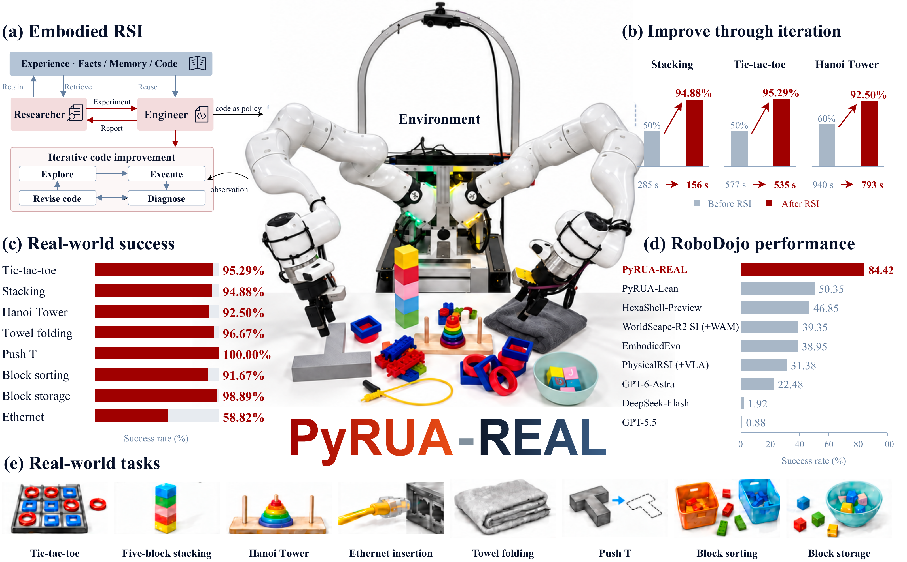

<div align="center">

# PyRUA-REAL: Robot Exploration and Adaptive Learning through RSI in the Real World

Qiang Wang<sup>1,*</sup>, Jianxin Bi<sup>1,3,*,‡</sup>, Shulong Jiang<sup>1,*</sup>, Ruiyang Si<sup>1</sup>, Wenbo Huang<sup>1</sup>, Kaiqi Chen<sup>1</sup>, Jiaxin Li<sup>1</sup>, Liyun Li<sup>2</sup>, Xuanyi Li<sup>2,†</sup>, Daquan Zhou<sup>1,†</sup>

<sup>1</sup>Peking University &nbsp; <sup>2</sup>EngineAI &nbsp; <sup>3</sup>National University of Singapore

<sup>*</sup>Equal contribution &nbsp; <sup>‡</sup>Project lead &nbsp; <sup>†</sup>Corresponding author

[](https://dagroup-pku.github.io/PyRUA-Lean/real/)
[](https://arxiv.org/abs/2611.06768)
[](https://huggingface.co/papers/2611.06768)
[](LICENSE)

[🌐 Project Page](https://dagroup-pku.github.io/PyRUA-Lean/real/) · [📄 Paper](https://arxiv.org/pdf/2611.06768) · [🎬 Videos](https://dagroup-pku.github.io/PyRUA-Lean/real/#performance)

</div>

**PyRUA-REAL** studies how coding agents turn physical interaction into lasting robot capabilities.
Agents explore tasks on real robots, revise programs using execution feedback, and retain what they
learn as persistent memory and reusable skills. The foundation model parameters stay fixed;
improvement is stored in code and experience.

<p align="center">
  
</p>

This branch contains the **project website and its assets**. The robot-control framework and
experiment implementation are not included in this branch.

## 🔥 News

- [2026/11/04] 📄 The [PyRUA-REAL paper](https://arxiv.org/abs/2611.06768) is on arXiv.
  Explore the [project page](https://dagroup-pku.github.io/PyRUA-Lean/real/) for task videos,
  development histories, and interactive results.

## 💡 How it works

A **researcher agent** chooses experimental objectives and technical approaches. An **engineer
agent** implements programs, runs robot trials, and diagnoses failures. Their reports connect local
code revisions with decisions about when to refine an approach or try a different one.

A persistent repository retains environmental facts, attempted approaches, outcomes, and reusable
implementations. Later experiments use this experience to develop and adapt robot skills. For
deployment, the resulting programs can run without online language-model decisions while still
using live observations for perception, control, and recovery.

The study examines improvement beyond first success, agent collaboration, execution feedback,
explicit task requirements, skill transfer, and the efficiency of deployment without an online agent.

## 📊 Results

### Real-world manipulation

Experiments cover eight tasks on a dual-arm Franka platform: tic-tac-toe, five-block stacking,
Tower of Hanoi, towel folding, Push T, block sorting, block storage, and Ethernet insertion.

The average recorded success rate is **91.1% across the eight tasks**. These are development
statistics aggregated across attempts and program revisions, not a held-out evaluation of one
frozen policy. Seven tasks yield agent-free skills; Ethernet insertion uses online agent assistance.
The paper evaluates frozen-program deployment separately.

See the [task videos](https://dagroup-pku.github.io/PyRUA-Lean/real/#performance),
[real-world results](https://dagroup-pku.github.io/PyRUA-Lean/real/#real-world-charts), and
[continued improvement](https://dagroup-pku.github.io/PyRUA-Lean/real/#result-improvement).

### RoboDojo

Complementary evaluation covers **42 RoboDojo tasks** across generalization, precision,
long-horizon execution, memory, and open-ended tasks. The paper abstract and project page report
**84.4% average success**. The website provides an
[interactive comparison by capability group](https://dagroup-pku.github.io/PyRUA-Lean/real/#result-benchmark).

## 📖 Citation

```bibtex
@article{wang2026pyruareal,
  title={PyRUA-REAL: Robot Exploration and Adaptive Learning through RSI in the Real World},
  author={Wang, Qiang and Bi, Jianxin and Jiang, Shulong and Si, Ruiyang and Huang, Wenbo and Chen, Kaiqi and Li, Jiaxin and Li, Liyun and Li, Xuanyi and Zhou, Daquan},
  journal={arXiv preprint arXiv:2611.06768},
  year={2026},
  url={https://arxiv.org/abs/2611.06768}
}
```

## 🤗 License

Repository code is licensed under [Apache License 2.0](LICENSE). The bundled HLS player retains
its [upstream license](website/vendor/hls-LICENSE.txt).
