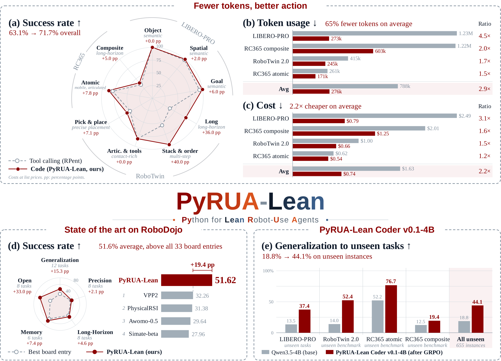

<p align="center">
  <picture>
    <source media="(prefers-color-scheme: dark)" srcset="docs/assets/logo-dark.svg">
    
  </picture>
</p>

<h3 align="center">
<a href="https://dagroup-pku.github.io/PyRUA-Lean/"><b>🌐 Project Page</b></a> |
<a href="https://arxiv.org/abs/2610.01939"><b>📄 Paper</b></a> |
<a href="https://dagroup-pku.github.io/PyRUA-Lean/docs/"><b>📚 Docs</b></a> |
<a href="https://huggingface.co/DAGroup-PKU/PyRUA-Lean-Coder-v0.1-4B"><b>🤗 Model</b></a>
</h3>

<p align="center">
  <a href="https://dagroup-pku.github.io/PyRUA-Lean/"></a> &ensp;
  <a href="https://arxiv.org/abs/2610.01939"></a> &ensp;
  <a href="https://huggingface.co/DAGroup-PKU/PyRUA-Lean-Coder-v0.1-4B"></a> &ensp;
  <a href="LICENSE"></a> &ensp;
  <a href="pyproject.toml"></a>
</p>

**PyRUA-Lean** (*Py*thon for lean *R*obot-*U*se *A*gents, the robot counterpart of computer-use agents)
turns a robot into a Python object. A tool-calling agent spends a full LLM call on every small step of a task
and re-sends everything before it each time. A PyRUA-Lean agent writes code against `robo` instead, so one call
can find an object, move above it, grasp, check the gripper and try again.

<p align="center">
  <picture>
    <source media="(prefers-color-scheme: dark)" srcset="docs/assets/overview-dark.png">
    
  </picture>
</p>

## 🔥 News

- [2026/10/21] 🦾 **Real robot**: on an AF8 dual-arm robot, GPT-6 Astra writes every Python cell and puts all five
  tabletop blocks into a bowl, in two independent uncut episodes (41 and 42 cells, about 22 minutes each).
  [[Videos]](https://dagroup-pku.github.io/PyRUA-Lean/#real-robot)
- [2026/10/15] 🤗 **PyRUA-Lean Coder v0.1-4B** is on Hugging Face. [[Model]](https://huggingface.co/DAGroup-PKU/PyRUA-Lean-Coder-v0.1-4B)
- [2026/10/13] 📄 **arXiv v2** is out as a technical report: it adds RoboDojo and PyRUA-Lean Coder v0.1-4B.
  [[Paper]](https://arxiv.org/abs/2610.01939)
- [2026/10/13] 🤖 **RoboDojo**: without any VLA policy or privileged information, PyRUA-Lean reaches a **51.62%**
  average success rate (Score 58.20), 19.4 points above the best entry of the public leaderboard (snapshot of October 9, 2026).
  The adapter is open as a pull request to XPolicyLab for RoboDojo's official evaluation
  ([XPolicyLab#168](https://github.com/XPolicyLab/XPolicyLab/pull/168)).
  [[Adapter]](integrations/xpolicylab)
- [2026/10/01] 📄 **arXiv v1** is out. [[Paper]](https://arxiv.org/abs/2610.01939v1)

## 💡 Introduction

PyRUA-Lean has three parts so far:

- **The framework.** The agent composes robot primitives, VLA policies among them, into Python cells that check
  and retry locally and return only the images and state it asks for. On 700 task instances from LIBERO-PRO,
  RoboTwin 2.0 and RoboCasa365, with the same GPT-6 Astra planner and the same primitives as tool calling, success
  goes from **63.1% to 71.7%**, with **49% fewer LLM calls** and **65% fewer input tokens** on the instances both
  agents solve.
- **RoboDojo.** With this library's own motion, gripper and perception primitives and the colour images of the
  benchmark's default observation, PyRUA-Lean reaches **51.62% average success rate (Score 58.20)**, first on all
  five dimensions of the public leaderboard (snapshot of October 9, 2026).
- **[PyRUA-Lean Coder v0.1-4B](https://huggingface.co/DAGroup-PKU/PyRUA-Lean-Coder-v0.1-4B).** Qwen3.5-4B trained with GRPO in the PyRUA-Lean framework, on 45 LIBERO-PRO
  instances, goes from **18.8% to 44.1%** on 655 task instances it never saw in training, above the Qwen3.5-27B base
  model (29.2%).

## 🚀 Quick start

LIBERO-PRO, RoboTwin 2.0 and RoboCasa365 run on the robot stacks of [RPent](https://github.com/RLinf/RPent): install
RPent with the robot you want first (the [Quick Start](https://dagroup-pku.github.io/PyRUA-Lean/docs/getting-started/quickstart/) goes through it step by step).
RoboDojo runs through XPolicyLab and needs no RPent ([RoboDojo](https://dagroup-pku.github.io/PyRUA-Lean/docs/robots/robodojo/)). Agents run through the
[Codex CLI](https://github.com/openai/codex) 0.155.1, Claude Code, or any OpenAI-compatible endpoint.

```bash
git clone https://github.com/DAGroup-PKU/PyRUA-Lean.git && cd PyRUA-Lean
uv pip install -e .       # into the Python environment of your RPent robot stack (or pip)
pyrualean api             # the robot API the agent sees; no simulator needed
npm install -g @openai/codex@0.155.1 && codex login      # the agent runtime

# one LIBERO-PRO episode: GPT-6 Astra writes code against robo, at most 40 code cells
export RPENT_ROOT=/path/to/rpent
pyrualean play --arm cells --suite libero_spatial_swap --task 7 --seed 2 \
    --model gpt-6-astra --max-turns 40 --budget-s 7200 --out runs/demo --cuda-device 0
pyrualean summarize runs/demo
```

The run directory keeps the episode video, every cell the agent ran with its output, the ledger of primitive
calls, the token usage and the benchmark's own verdict.

## 🦾 Robots

| Robot | Benchmark | Runs on | Robot and skills |
|---|---|---|---|
| `robodojo_xpl_rgb` | [RoboDojo](https://dagroup-pku.github.io/PyRUA-Lean/docs/robots/robodojo/) | [XPolicyLab](https://github.com/XPolicyLab/XPolicyLab), under RoboDojo's own evaluation client | two ARX-X5 arms; this library's own motion, gripper and perception primitives, SAM3; the three colour images of the default observation; no VLA |
| `libero` (default) | [LIBERO-PRO](https://dagroup-pku.github.io/PyRUA-Lean/docs/robots/libero/) | RPent | Franka arm; scripted servos, Pi0.5 VLA, SAM3 perception |
| `robotwin` | [RoboTwin 2.0](https://dagroup-pku.github.io/PyRUA-Lean/docs/robots/robotwin/) | RPent | two arms; LingBot-VLA |
| `robocasa` | [RoboCasa365](https://dagroup-pku.github.io/PyRUA-Lean/docs/robots/robocasa/) | RPent | mobile manipulator; RLDX-1 VLA, navigation |
| *real robot* | [Demos](https://dagroup-pku.github.io/PyRUA-Lean/#real-robot) | AF8 dual-arm robot | two arms, a head camera and two RGB-D wrist cameras; motion planning, gripper and perception primitives with force and torque guards; no VLA; integration coming soon |

New robots are added through XPolicyLab ([Adding a Robot](https://dagroup-pku.github.io/PyRUA-Lean/docs/robots/adding-a-robot/)).

## 📊 Performance

**Code cells against tool calling** (GPT-6 Astra, same primitives; calls, tokens and cost per solved episode on
the task instances both agents solved):

| Benchmark | Success, tool calling | Success, PyRUA-Lean | LLM calls | Input tokens | Cost |
|---|---|---|---|---|---|
| LIBERO-PRO | 83.0 | **94.0** | 21.4 → 8.4 | 1.23M → 273k | $2.49 → $0.79 |
| RoboTwin 2.0 | 60.0 | **69.2** | 12.2 → 8.9 | 415k → 245k | $1.00 → $0.66 |
| RC365 atomic | 78.9 | **86.7** | 10.4 → 5.6 | 261k → 171k | $0.62 → $0.54 |
| RC365 composite | 34.4 | **39.4** | 28.4 → 14.9 | 1.22M → 603k | $2.01 → $1.25 |
| **All** | 63.1 | **71.7** | 17.0 → 8.7 | 788k → 276k | $1.63 → $0.74 |

**RoboDojo** (success rate %, the leaderboard's average over its five dimensions; top entries of a snapshot
of the public leaderboard taken on October 9, 2026):

| Entry | Type | Average | Gen. | Prec. | Long-Hor. | Memory | Open |
|---|---|---|---|---|---|---|---|
| **PyRUA-Lean** (GPT-6 Astra) | Agent | **51.62** | **45.83** | **37.25** | **48.00** | **63.00** | **64.00** |
| VPP2 | WAM | 32.26 | 29.50 | 35.17 | 37.00 | 55.56 | 4.08 |
| PhysicalRSI | Agent + VLA | 31.38 | 15.62 | 32.50 | 37.33 | 46.56 | 24.92 |
| Awomo-0.5 | WAM | 29.64 | 23.84 | 33.50 | 26.75 | 41.22 | 22.92 |
| Simate-beta | VLA | 27.96 | 27.95 | 26.92 | 43.42 | 33.00 | 8.50 |

**PyRUA-Lean Coder v0.1-4B** (success rate %, PyRUA-Lean framework):

| Planner | Trained on (45) | LIBERO-PRO other (155) | RoboTwin 2.0 (250) | RC365 atomic (90) | RC365 composite (160) | All unseen (655) |
|---|---|---|---|---|---|---|
| Qwen3.5-4B | 37.8 | 13.5 | 14.0 | 52.2 | 12.5 | 18.8 |
| Qwen3.5-27B | 64.4 | **38.1** | 20.8 | 65.6 | 13.1 | 29.2 |
| **PyRUA-Lean Coder v0.1-4B** | **71.1** | 37.4 | **52.4** | **76.7** | **19.4** | **44.1** |

## 📖 Citation

If you use PyRUA-Lean, please cite our paper:

```bibtex
@article{si2026fewer,
  title={Fewer tokens, better action: GPT-6 Astra robot agents with 14\% higher success rate but 65\% fewer tokens},
  author={Si, Ruiyang and Bi, Jianxin and Yang, Shunyu and Ni, Rui and Huang, Wenbo and Wang, Qiang and Jiang, Shulong and Zhang, Yintianrun and Ruan, Feixiang and Zhang, Kewei and Wang, Duomin and Li, Xiuyu and Feng, Haiwen and Dong, Zhen and Zhou, Daquan},
  journal={arXiv preprint arXiv:2610.01939},
  year={2026}
}
```

## 🤗 License and acknowledgements

Apache License 2.0 ([LICENSE](LICENSE)). PyRUA-Lean builds on [RPent](https://github.com/RLinf/RPent)
(Apache-2.0): on LIBERO-PRO, RoboTwin 2.0 and RoboCasa365 its robot stacks, services and primitive implementations
do the work behind `robo`, the tool-calling baseline is RPent itself, and parts of this repository are adapted from
it; see `NOTICE`. If you use
RPent, please cite its paper, [Harness VLA: Steering Frozen VLAs into Reliable Manipulation Primitives via
Memory-Guided Agents](https://arxiv.org/abs/2607.08448).

## 🌟 Star History

[](https://star-history.com/#DAGroup-PKU/PyRUA-Lean&Date)
