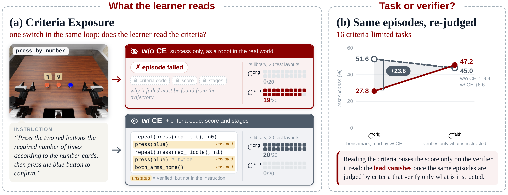
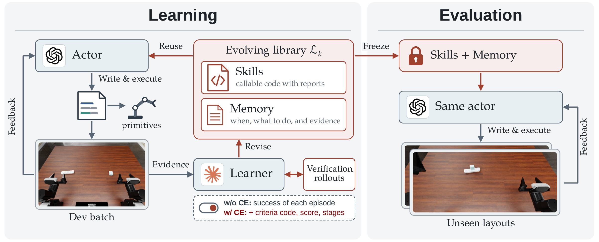
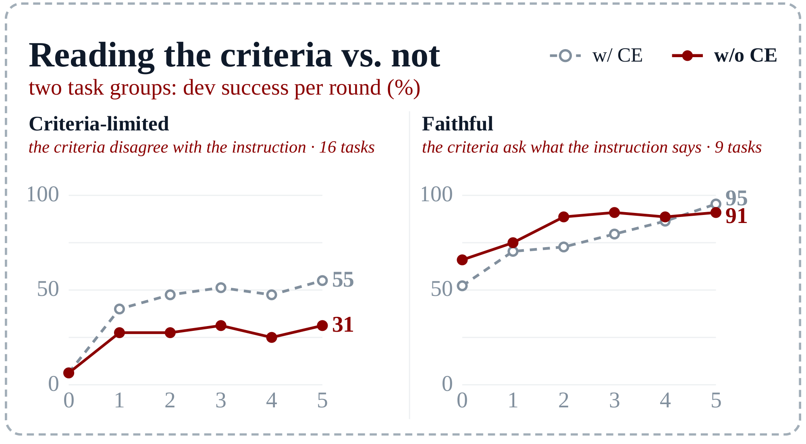
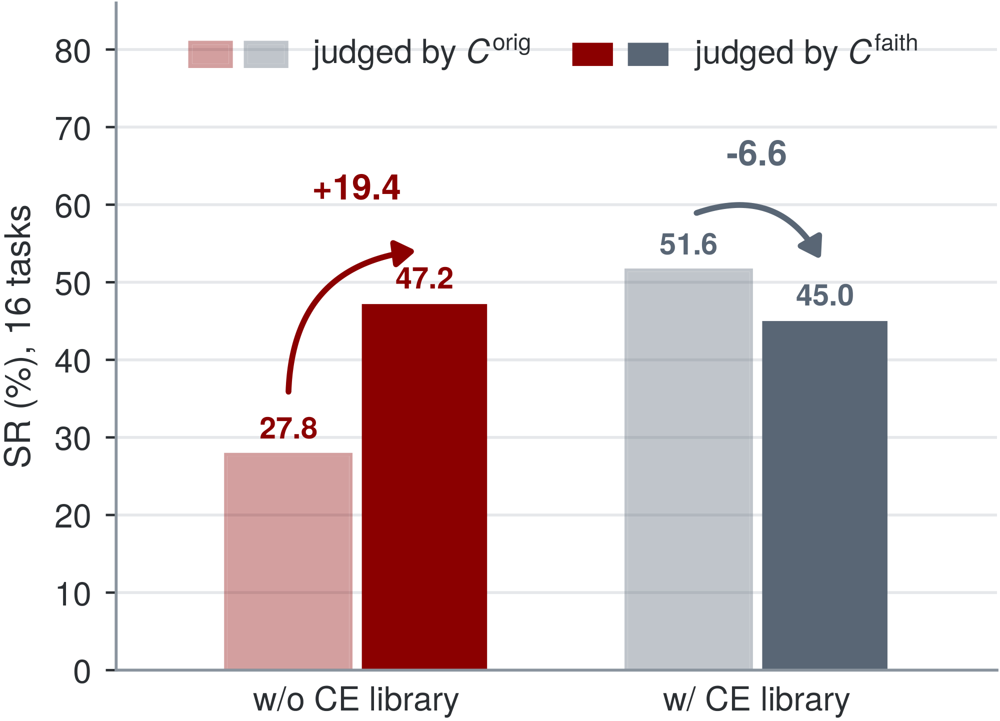
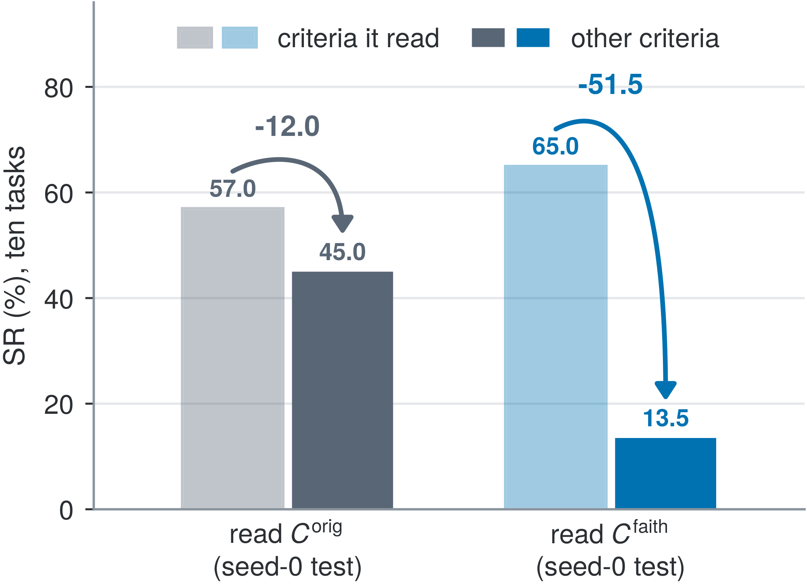
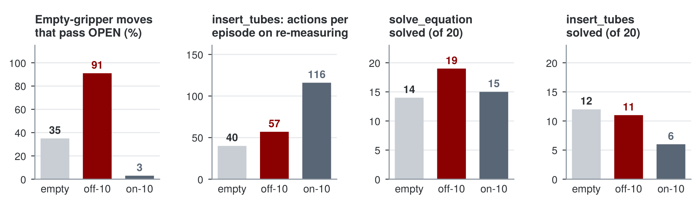

<div align="center">

# Learning the Task or Learning the Verifier? 重新审视具身自我改进中的判定暴露（Criteria Exposure）

Wenbo Huang<sup>1</sup>, Jianxin Bi<sup>1,2</sup>, Shunyu Yang<sup>1</sup>, Ruiyang Si<sup>1</sup>, Rui Ni<sup>1</sup>, Qiang Wang<sup>1</sup>, Shulong Jiang<sup>1</sup>, Yintianrun Zhang<sup>1</sup>, Feixiang Ruan<sup>1</sup>, Kewei Zhang<sup>1</sup>, Ye Huang<sup>1</sup>, Shukai Gong<sup>1</sup>, Daquan Zhou<sup>1,†</sup>

<sup>1</sup>Peking University &nbsp; <sup>2</sup>National University of Singapore

<sup>†</sup>Corresponding author

[](https://dagroup-pku.github.io/PyRUA-Lean/RSIJudge/)
[](https://arxiv.org/abs/2611.08318)
[](LICENSE)

</div>

<p align="center">
  
</p>

具身自我改进智能体通常在机器人仿真基准上开发和比较，其中不少会让学习者读取基准的成功判定，我们称之为
**判定暴露（Criteria Exposure, CE）**。但这些判定是为从示范中训练出来的策略写的，常常比指令要求得更多：
RoboDojo 的 `press_by_number` 要求蓝色按钮恰好按两次、且夹在两组红色之间，而指令里从未说过（上图 a）。

**学习者读到判定之后，它学到的代码是更会做指令里的任务，还是过拟合到了判定规则上？** 我们让同一个自我改进
循环只差一个开关地跑两种设置，并把每一局测试都判两次：用基准原判定 $C^{orig}$，以及只检查指令要求的忠实判定
$C^{faith}$。在原判定下判定暴露领先，51.6% 对 27.8%；同一批局换成忠实判定，变成 45.0% 对 47.2%，领先消失（上图 b）。

本仓库包含复现这项研究所需的全部代码：自我改进循环、忠实判定与双判定、评测、向新任务以及 LIBERO-PRO 和
RoboCasa365 的库迁移，以及每个实验的配置。

## 研究怎么做

<p align="center">
  
</p>

- **Actor**（冻结）：GPT-6 Astra（reasoning effort high），针对 [PyRUA-Lean](https://github.com/DAGroup-PKU/PyRUA-Lean)
  的机器人 API `robo` 编写并执行 Python cell。可用的是 RGB 感知（SAM 3 与多视角测量）和运动原语，没有 VLA，
  也拿不到深度或仿真状态。
- **Learner**：Claude Code + Claude Opus 5.5（effort high）。每批之间，它根据上一批的证据给每个任务的**库**做一次修订：
  **技能**（会报告自己做了什么的可调用代码）和**经验**（什么时候该做什么，附证据），并用验证 rollout 检查改动。
- **循环**：每个任务在 5 个开发布局上学 5 轮；某批明显低于最好一批时回滚。除库以外全部冻结。
- **唯一的开关**：learner 能读到什么。

| 设置 | learner 能读到 | 开关 |
|---|---|---|
| **w/o CE** | 轨迹和每局是否成功，与真实世界里机器人能得到的一样 | `--worker-scoring off` |
| **w/ CE** | 另加该任务的判定代码、每局的 score 和 stages | `--worker-scoring on` |

25 个学习任务中，16 个是**判定受限**任务（判定在某些轨迹上与指令不一致），9 个是**忠实**任务，分组在看到任何结果之前就已确定。
我们只改写判定受限任务的判定代码，得到 $C^{faith}$（[`faithful_criteria/`](faithful_criteria/README.md)）：去掉隐藏规则、修掉缺陷、
把硬阈值放宽到仍然明确满足指令的程度，并保留双臂回原位的要求。

## 结论

### 1. 只有判定比指令要求更多时，判定暴露才有用

<p align="center">
  
</p>

原判定下的测试成功率（%，seed 0 的布局 0–19；括号内为相对空库的变化）：

| 任务 | 空库 | w/o CE | w/ CE |
|---|:---:|:---:|:---:|
| 全部（25） | 24.6 | 47.8 (+23.2) | 62.0 (+37.4) |
| 判定受限（16） | 8.4 | 27.8 (+19.4) | **51.6 (+43.2)** |
| 忠实（9） | 53.3 | **83.3 (+30.0)** | 80.6 (+27.3) |

只靠成功信号学习就能把成功率翻倍；读判定再多出的 14.2 个点全部来自判定受限任务。判定与指令一致的任务上，两种设置持平。

### 2. 领先跟着它读过的判定走

<table>
  <tr>
    <td width="50%" align="center"></td>
    <td width="50%" align="center"></td>
  </tr>
  <tr>
    <td><b>同一批局重判。</b>原判定下，只有暴露库成功的布局有 93 个，只有仅看成功的库成功的有 17 个；换成忠实判定后是 47 对 54（p = 0.55）。差距缩小 25.9 个点（按任务 bootstrap 的 95% 区间为 4.7–54.4）。</td>
    <td><b>交换 learner 读的判定。</b>读 C<sup>faith</sup> 学出的库，在 C<sup>faith</sup> 下是 65.0%，在 C<sup>orig</sup> 下只有 13.5%；读 C<sup>orig</sup> 学出的库则从 57.0% 降到 45.0%。每个暴露库都只在自己读过的判定下最好。</td>
  </tr>
</table>

### 3. 判定暴露多学到的东西迁移不出去

把 10 个源任务的库按设置各蒸馏成一个共享库，用到源任务没有覆盖的新任务上；再翻译到各目标基准的原语上，用于
LIBERO-PRO 和 RoboCasa365（成功局数；括号内为相对空库的变化）：

| 目标 | 库来源 | 空库 | w/o CE | w/ CE |
|---|---|:---:|:---:|:---:|
| RoboDojo，10 个新任务 × 20 布局 | RoboDojo | 65/200 | **80/200** (+15) | 71/200 (+6) |
| LIBERO-PRO，6 个任务 × 10 seed | RoboDojo | 45/60 | 48/60 (+3) | 46/60 (+1) |
| RoboCasa365，10 个任务 × 10 seed | RoboDojo | 22/100 | 24/100 (+2) | 24/100 (+2) |
| RoboCasa365，10 个任务 × 10 seed | RoboCasa365 | 22/100 | **33/100** (+11) | 29/100 (+7) |

判定暴露在自己学过的任务上那 14 个点的领先，到新任务上没有再出现；跨基准时，只有在目标基准内部积累的经验才有帮助。

<details>
<summary>RoboDojo 内部迁移了什么（案例）</summary>

<p align="center">
  
</p>

通用规则能迁移，单任务的精细技巧不能。面对同样的源任务失败，仅看成功的 learner 追到了根因，蒸馏出的库（off-10）
里有一条通用规则：空夹爪的每次移动都传 `OPEN`。actor 在新任务上照做（这类移动中占 91%，空库是 35%），需要夹起
薄圆片的 `solve_equation` 因此升到 19/20。暴露库（on-10）留下的是单任务公式，并要求大多数动作之前都精测到 1 mm：
在 `insert_tubes` 上，它每局 500 个动作里有 116 个花在精测上，只解出 6/20，空库是 12/20。
</details>

**启示**：只给 learner 真实世界里机器人能得到的反馈，并让基准的判定只检查指令要求的内容。换了判定仍然成立的提升，
才反映智能体对任务本身学到了什么。

## 目录

| 路径 | 内容 |
|---|---|
| `src/pyrualean/` | PyRUA-Lean 包：机器人（`robodojo_xpl_rgb`、`libero_rgb`、`robocasa_rgb`）、prompt、agent runtime（OpenAI 兼容、Codex CLI、replay），以及自我改进循环 `pyrualean.learn` |
| `faithful_criteria/` | RoboDojo 的忠实判定 $C^{faith}$：判定代码的 overlay，构建成每局同时用两套判定判的 source root |
| `eval/robodojo/` | RoboDojo：在留出布局上评测 learn campaign 的最终库；`eval/robodojo/compare.py` 逐布局配对两种设置 |
| `eval/libero/`、`eval/robocasa/` | LIBERO-PRO、RoboCasa365 上的同类评测，多组库并排 |
| `transfer/` | 把 10 个源任务的库蒸馏成一个；把 RoboDojo 的库翻译到 LIBERO-PRO 和 RoboCasa365 |
| `configs/` | 论文的 learn campaign 和评测计划（模板） |
| `tools/` | 环境、配置渲染、启动脚本、干净的 CLI 包装、离线测试、发布前检查 |
| `docs/` | [环境搭建](docs/SETUP.md) · [模型与凭据](docs/MODELS.md) · [复现论文](docs/REPRODUCE.md)（英文） |

## 快速开始

```bash
cp paths.env.example paths.env && $EDITOR paths.env      # 本机路径，见 docs/SETUP.md
source tools/env.sh
bash tools/test_offline.sh "$CE_PYTHON"                  # 离线测试：不开仿真、不用 GPU、不调模型

export ACTOR_API_KEY=...                                 # actor 的 OpenAI 兼容端点
python tools/render_config.py configs/learn/robodojo/smoke.json runs/smoke.json
python -m pyrualean.learn.campaign runs/learn/smoke init --config runs/smoke.json
python -m pyrualean.learn.campaign runs/learn/smoke check-services
bash tools/run_learn.sh runs/learn/smoke --worker-scoring off

# 跑完后导出它的库，在 seed 0 的一个布局上测一局
python tools/render_config.py configs/eval/robodojo/smoke.json runs/eval-smoke.json
python eval/robodojo/export.py runs/eval/smoke --config runs/eval-smoke.json
bash eval/robodojo/run_eval_env.sh runs/eval/smoke
python eval/robodojo/run.py runs/eval/smoke report
```

learner 用 `claude` CLI 自己的登录（`tools/claude-clean auth login`）或 `ANTHROPIC_API_KEY`；网关和 Codex runtime
见 [docs/MODELS.md](docs/MODELS.md)。论文每个实验的命令按章节列在 [docs/REPRODUCE.md](docs/REPRODUCE.md)。

## 复现须知

- 调模型要花钱：learn 一轮是 5 局 actor 加 1 次 learner 会话；测试是每个任务、每个库 20 局。先跑 smoke 配置。
- 开发用评测 seed 1 的布局 0–4，测试用 seed 0 的布局 0–19；基准标为不稳定的布局，按官方顺序用下一个布局顶替。
- 开发批的噪声很大，结论以测试布局上的逐布局配对比较为准（`eval/robodojo/compare.py`）。
- 代码、基准或执行设置与学库时不一致时，评测会拒绝运行（execution identity 会被记录并核对）；actor 的 prompt 一旦改变，
  `tests/test_paper_prompts.py` 就会失败。

## 引用与许可

论文：[arXiv:2611.08318](https://arxiv.org/abs/2611.08318)。引用格式见 [README.md](README.md#citation) 或 [CITATION.cff](CITATION.cff)。代码采用 Apache License 2.0
（见 [LICENSE](LICENSE)、[NOTICE](NOTICE)）；`faithful_criteria/reward_manager/` 和 `faithful_criteria/tasks/` 是 RoboDojo 文件的修改版（MIT License）；
`docs/assets/` 中的图来自论文。
