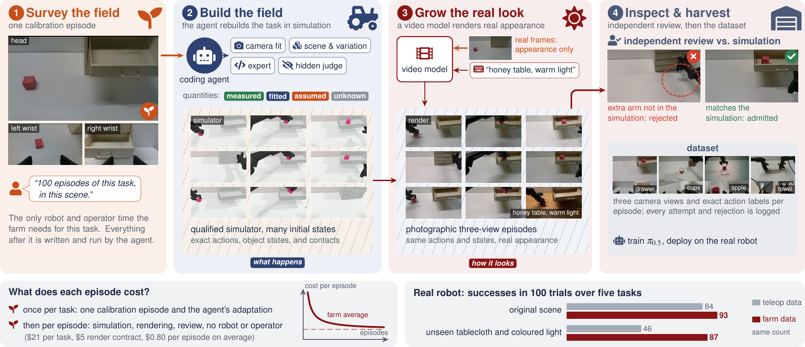
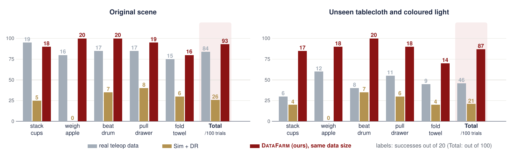

# PyRUA-DataFarm

<p align="center"><b>PyRUA-DataFarm: LLM Agent as a Cost-Efficient Teleoperator for Real-Ready Robot Data</b></p>

<p align="center">
  <a href="https://dagroup-pku.github.io/PyRUA-Lean/DataFarm/"></a>
  <a href="https://arxiv.org/abs/2611.05320"></a>
  <a href="https://github.com/DAGroup-PKU/PyRUA-Lean/tree/DataFarm"></a>
  <a href="https://github.com/DAGroup-PKU/PyRUA-Lean/blob/DataFarm/LICENSE"></a>
</p>

This page covers installing PyRUA-DataFarm, connecting a coding agent, running a new task, and the results of the
paper. The code is on the [`DataFarm` branch](https://github.com/DAGroup-PKU/PyRUA-Lean/tree/DataFarm), whose
README and `docs/` hold the full documentation.

??? abstract "Abstract"

    Teleoperation remains the default way to collect robot demonstrations, but every episode costs robot and
    operator time, and every new task starts from scratch. We ask whether a coding agent can take over the
    teleoperator's job. In our DataFarm, the agent receives a data request and one calibration episode of the robot
    in the target scene and rebuilds the task in simulation: it writes the scene, an expert controller, and a
    success judge. The simulator supplies exact actions, and a video model conditioned on real images renders each
    rollout as photographic video, generating all camera views together consistently. The output is real-ready
    data: synchronized camera views labelled with the robot's actions, on which a policy can be trained directly
    and deployed on the real robot. Independent judges certify the expert and every rendered episode before
    admission. On five real-robot tasks, policies trained only on farm data match policies trained on as many
    teleoperated episodes (93 vs. 84 successes in 100 trials), and under an unseen tablecloth and coloured light
    they keep 87 successes where the teleoperation-trained policies fall to 46. Adapting a task is fully automatic
    and costs $21 of API usage on average, paid once per task, plus $5 for a render contract; every further
    episode costs $0.80 on average for simulation, rendering, and review, with no robot or operator. One hour of
    three-view data for a task costs $107 on average, these costs included, slightly below a quote of $117 for
    teleoperation in China and below $290 in labour alone in North America.



______________________________________________________________________

## Requirements

| Component | Needed for |
|---|---|
| Linux, Python 3.11 or later, `ffmpeg`, `bubblewrap` | the pipeline, media checks and the sandbox of the expert author |
| A coding agent: [SoL-Pi](https://github.com/NVlabs/SoL-Pi), Claude Code or Codex | running the farm; DataFarm ships no model or agent |
| A simulator (SAPIEN with RoboTwin 2.0 assets, or Isaac Sim) and robot assets | building the task and recording episodes |
| One GPU with at least 172 GB free per worker | the default MiniMax-H3 control-hybrid renderer |
| [USDCraft](https://github.com/NVlabs/USDCraft) (optional) | generating object assets the scene is missing |

!!! note
    The repository contains no simulators, video models, robot assets, data or credentials. Point DataFarm at the
    components you installed with runtime bindings
    ([deployment](https://github.com/DAGroup-PKU/PyRUA-Lean/blob/DataFarm/docs/deployment.md)).

______________________________________________________________________

## Installation

```bash
git clone --branch DataFarm --single-branch https://github.com/DAGroup-PKU/PyRUA-Lean.git && cd PyRUA-Lean
pip install -e '.[dev,workflow]'
$EDITOR bindings.json                  # or point DATAFARM_BINDINGS at the file, or set DATAFARM_<KEY>
datafarm doctor --profile core         # check prerequisites, no API or GPU calls
make test lint audit                   # CPU tests, standing-rules lint, instruction-layer audit
```

______________________________________________________________________

## Running a Task

### Connecting a Coding Agent

`supervise` runs the agent you choose through a runtime config:

| Harness | Runtime config | Before the first run |
|---|---|---|
| SoL-Pi | `examples/runtime/pi-solpi.json` | install Pi and SoL-Pi and configure a model |
| Claude Code | `examples/runtime/claude-code.json` | install Claude Code and log in |
| Codex | `examples/runtime/native-codex.json` | install Codex and run `codex login` |

### A New Task

Save the user's request verbatim in a text file; everything task-specific (scene, expert, judge, render prompts)
is generated by the agent.

```bash
# bind the episode and the request to a new task workspace
python tools/pipeline_agent.py prepare --episode /data/episode.mp4 \
  --request-file /data/request.txt --target-count 100 --output /data/task

# compile the orchestrator's instructions into an explicit, hash-recorded context
python tools/pipeline_agent.py context --work /data/task --role orchestrator --output /data/task/context

# run the coding agent until the task is delivered, recovering from crashes
python tools/pipeline_agent.py supervise --work /data/task --config examples/runtime/native-codex.json

# check the delivery: complete, unmodified, reviewed episode by episode
python tools/pipeline_agent.py verify --work /data/task
```

A task counts as complete only when `verify` accepts its delivery. To control cost, run the task phase by phase
with `tools/pipeline_phases.py`: each phase is one fresh agent session with a USD cap, and independent reviewers
decide the contract, the expert and each episode
([phased runs](https://github.com/DAGroup-PKU/PyRUA-Lean/blob/DataFarm/docs/reference/phased-runs.md)).

______________________________________________________________________

## Results

### Real Robot

π<sub>0.5</sub> policies trained on 100 episodes from each source, 20 trials per task and condition, five tasks on
PiPER arms.

| On five real-robot tasks | Teleoperated data | DataFarm data |
|---|---:|---:|
| Successes in the original scene (of 100 trials) | 84 | **93** |
| Successes under an unseen tablecloth and coloured light (of 100 trials) | 46 | **87** |
| Cost per further episode | robot and operator time | **$0.80** of simulation, rendering and review |



### Cost

Adapting a task is fully automatic and costs $21 of API usage on average, paid once per task, plus $5 for a render
contract. One hour of synchronized three-view data for a task costs $107 on average, these costs included,
slightly below a quote of $117 for teleoperation in China and below $290 in labour alone in North America.

______________________________________________________________________

## Related

- [README of the `DataFarm` branch](https://github.com/DAGroup-PKU/PyRUA-Lean/tree/DataFarm#readme): the pipeline
  stage by stage, design principles, reproducing the paper and limitations.
- [Quickstart](https://github.com/DAGroup-PKU/PyRUA-Lean/blob/DataFarm/docs/quickstart.md) and
  [troubleshooting](https://github.com/DAGroup-PKU/PyRUA-Lean/blob/DataFarm/docs/troubleshooting.md): running,
  stopping and resuming a task.
- [Architecture](https://github.com/DAGroup-PKU/PyRUA-Lean/blob/DataFarm/docs/architecture.md): how the stages,
  records and runtimes fit together.

## Citation

```bibtex
@misc{datafarm2026,
  title  = {PyRUA-DataFarm: LLM Agent as a Cost-Efficient Teleoperator for Real-Ready Robot Data},
  author = {Zhang, Kewei and Ma, Juncheng and Lv, Guodong and Wang, Duomin and Ruan, Feixiang and Si, Ruiyang and
            Zhang, Chuanrui and Chen, Yuxuan and Chen, Hao and Liu, Yichen and Zhang, Yintianrun and Deng, Yufan and
            Xie, Enze and Zhou, Daquan},
  year   = {2026},
  eprint = {2611.05320},
  archivePrefix = {arXiv},
  url    = {https://arxiv.org/abs/2611.05320}
}
```
