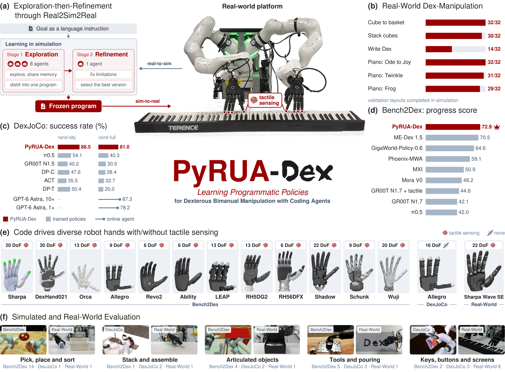

# PyRUA-Dex

<p align="center"><b>PyRUA-Dex: Learning Programmatic Policies for Dexterous Bimanual Manipulation with Coding Agents</b></p>

<p align="center">
  <a href="https://vme0522.github.io/PyRUA-Dex/"></a>
  <a href="https://arxiv.org/abs/2611.33144"></a>
  <a href="https://github.com/DAGroup-PKU/PyRUA-Lean/tree/dex"></a>
</p>

This page covers how PyRUA-Dex learns a program for a dexterous task, and the results of the paper on Bench2Dex,
DexJoCo and a real bimanual platform. The code is on the
[`dex` branch](https://github.com/DAGroup-PKU/PyRUA-Lean/tree/dex).

??? abstract "Abstract"

    Learning for dexterous manipulation is limited by the scarcity of high-quality demonstrations: retargeting from
    human video is imprecise, teleoperation gives no force feedback to the operator, and exoskeleton-based
    collection is hard to scale up. We present PyRUA-Dex, a framework that enables coding agents to develop
    dexterous manipulation through programmatic policy, without the need of demonstrations. The programmatic policy
    is developed in two stages: during exploration, multiple agents explore in parallel for task skills and ways to
    compose them, and a distilling agent condenses the successful attempts into a task library and one program.
    During refinement, this program is improved through randomized layouts for enhanced robustness and execution
    efficiency. In simulated environments, PyRUA-Dex achieves SOTA on Bench2Dex with a score of 72.9 and reaches
    81.0% success on DexJoCo under full randomization, ahead of every trained policy on both benchmarks. In real
    world experiments on a bimanual platform with two 22-DoF hands, PyRUA-Dex learns to play piano, write
    calligraphy, and other tasks efficiently: learning a new piece from sheet music takes as little as 30 minutes.
    These results suggest that PyRUA-Dex is an effective framework for developing dexterous manipulation policies
    with coding agents in the absence of high quality dexterous manipulation demonstrations.



______________________________________________________________________

## How It Works

A task's policy is a Python program: from the calibrated camera images, the joint positions of arms and hands and
the fingertip tactile maps, it computes joint-position targets. Coding agents write it in simulation, in two stages.

- **Exploration.** Eight agents explore the task in parallel for skills and ways to compose them. A distilling
  agent condenses the successful attempts into a task library and one program.
- **Refinement.** The program is improved on randomized layouts for robustness and execution efficiency.

The program is then frozen: at evaluation time it calls no language model. On the real platform, refinement runs
in rounds, and what the robot reveals after each round is written back into the simulation before the next
([Method](https://vme0522.github.io/PyRUA-Dex/#method)).

______________________________________________________________________

## Results

### Bench2Dex

26 tasks; success rate % per channel and the four-channel means (SR, Score); the five best trained entries of the
paper's Table 1. Demos: trained on the benchmark's teleoperated demonstrations.

| Method | Type | Demos | None | Equi. | Inv. | Full | SR | Score |
|---|---|---|---|---|---|---|---|---|
| **PyRUA-Dex** | Agent | no | **60.8** | **62.1** | **58.0** | **61.5** | **60.6** | **72.9** |
| PyRUA-Dex, exploration only | Agent | no | 44.9 | 45.8 | 44.3 | 43.4 | 44.6 | 59.1 |
| ME-Dex 1.5 | VTA | yes | 65.3 | 55.8 | 57.2 | 56.1 | 58.6 | 70.5 |
| GigaWorld-Policy-0.6 | WAM | yes | 55.4 | 48.2 | 51.4 | 50.5 | 51.4 | 64.6 |
| Phoenix-MWA | WAM | yes | 54.2 | 38.5 | 44.1 | 45.6 | 45.6 | 59.1 |
| MXI | VLA | yes | 38.4 | 37.3 | 35.8 | 36.0 | 36.9 | 50.9 |
| Mora V0 | VLA | yes | 38.8 | 29.5 | 32.5 | 32.1 | 33.2 | 48.2 |

### DexJoCo

11 tasks on the 16-DoF Allegro hand in MuJoCo; success rate %, three seeds of 50 episodes per task and setting.
LLM: a language model acts during evaluation, at 1× and 10× the benchmark's step budget
([DexJoCo results](https://vme0522.github.io/PyRUA-Dex/#dexjoco)).

| Method | Type | Demos | LLM | rand-obj | rand-full |
|---|---|---|---|---|---|
| **PyRUA-Dex** | Agent | no | no | **88.5** | 81.0 |
| PyRUA-Dex, exploration only | Agent | no | no | 58.7 | 64.1 |
| π<sub>0.5</sub> | VLA | yes | no | 54.1 | 40.3 |
| DP-T | IL | yes | no | 50.4 | 20.0 |
| DP-C | IL | yes | no | 47.6 | 28.4 |
| GR00T N1.5 | VLA | yes | no | 40.2 | 30.5 |
| ACT | IL | yes | no | 35.5 | 22.7 |
| GPT-6 Astra agent, 1× | Agent | in context | yes | – | 78.2 |
| GPT-6 Astra agent, 10× | Agent | in context | yes | – | **87.3** |

### Real World

Two Franka FR3 arms with two Sharpa Wave SE hands (22 joints each), a ZED-M stereo camera above the table and a
RealSense D405 on each wrist. All learning takes place in a calibrated MuJoCo simulation of the platform, and only
frozen programs run on the robot. Validation layouts completed in simulation (of 32) after exploration and after
the last round of refinement:

| Task | Goal | Exploration | Refinement | Rounds |
|---|---|---|---|---|
| Cube to basket | each hand puts its cube in the basket | 29 | 32 | 1 |
| Stack cubes | a tower of three cubes | 6 | 30 | 4 |
| Write Dex | take the brush and write "Dex" on the cloth | 3 | 14 | 1 |
| Ode to Joy | piano, the right hand, eight phrases | 29 | 32 | 5 |
| Twinkle, Twinkle | piano, two hands, six phrases | 29 | 31 | 4 |
| Little Jumping Frog | piano, two hands, eight phrases | 23 | 29 | 1 |
| **Total** | | 119/192 | **168/192** | |

The piano tasks share one skill, a player distilled from the learned programs: with it, a new piece from sheet
music takes as little as 30 minutes. Videos of the frozen programs on the robot are on the
[project page](https://vme0522.github.io/PyRUA-Dex/#real).

______________________________________________________________________

## Related

- [PyRUA-Lean](pyrua-lean.md): the PyRUA harness in which robot-use agents act through Python cells.
- [PyRUA-REAL](real.md): coding agents that refine robot programs on physical robots.

## Citation

```bibtex
@article{ruan2026pyruadex,
  title   = {{PyRUA-Dex}: Learning Programmatic Policies for Dexterous Bimanual
             Manipulation with Coding Agents},
  author  = {Ruan, Feixiang and Lv, Guodong and Zhang, Kewei and Huang, Wenbo and
             Zhang, Yintianrun and Wang, Qiang and Si, Ruiyang and Yang, Shunyu and
             Jiang, Shulong and Duan, Weicheng and Ni, Rui and Bi, Jianxin and
             Wang, Lekai and Fan, Yuze and Li, Haobo and Fu, Zeliang and
             Zhang, Jiankun and Wang, Duomin and Xie, Enze and Zhou, Daquan},
  journal = {arXiv preprint arXiv:2611.33144},
  year    = {2026}
}
```
